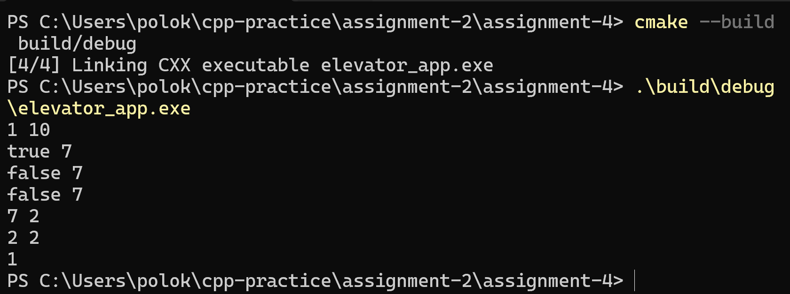
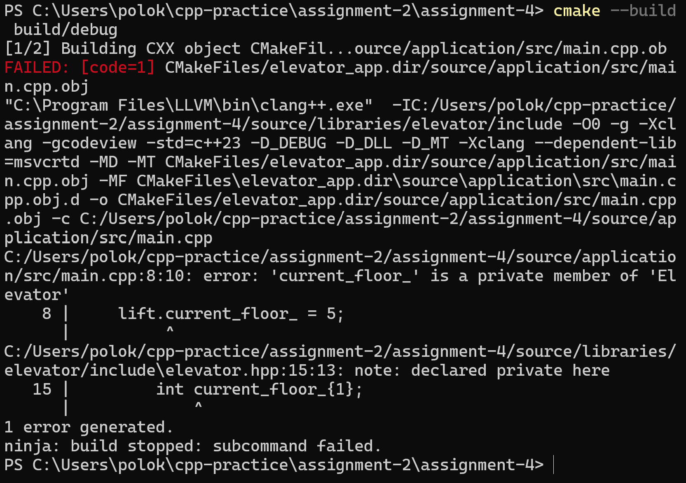
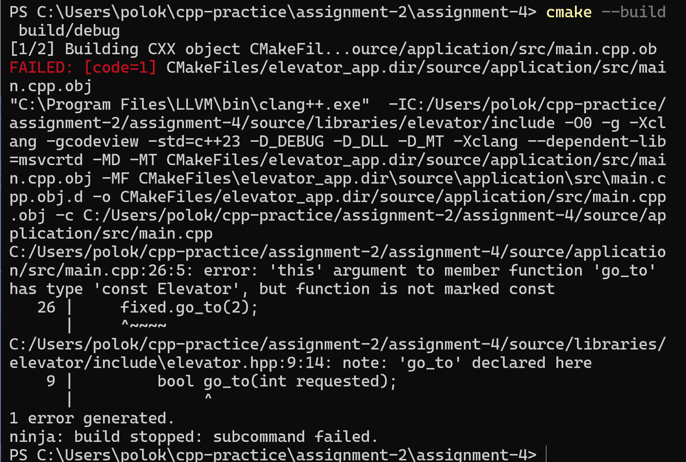
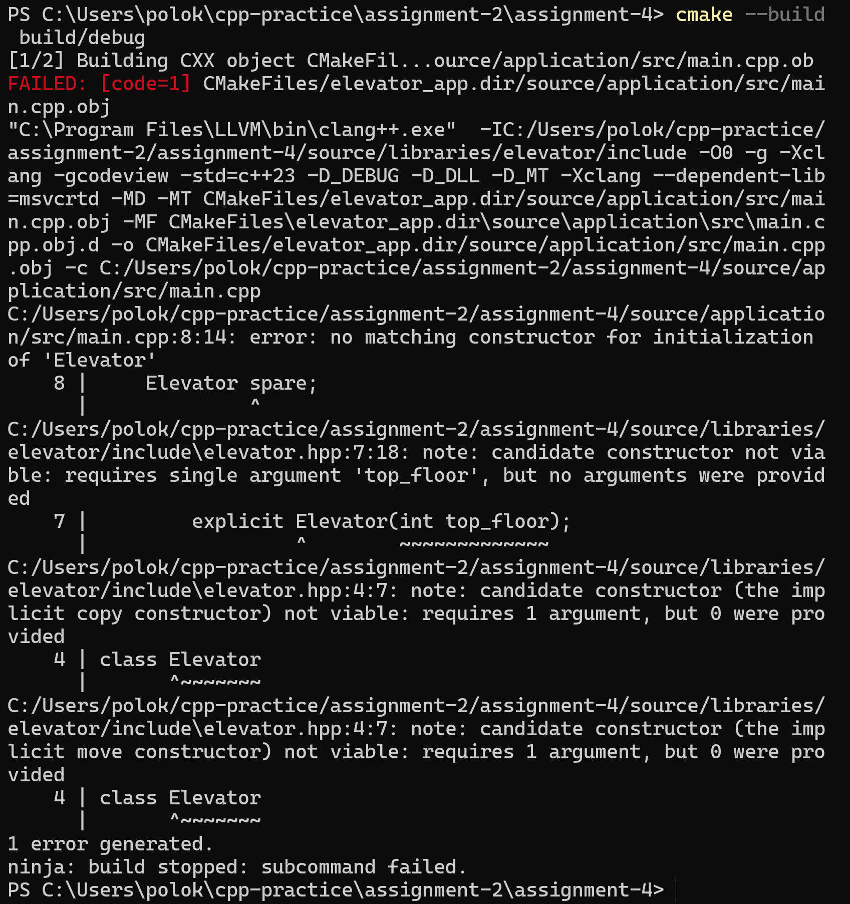
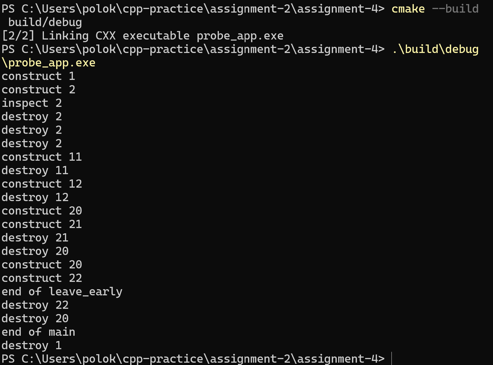

# Homework Assignment 4 - Polosnka Kristina

## 2. Build and run elevator_app

## 3. Access and const experiments

### 3.1 Insert lift.current_floor_ = 5;

current_floor_ is initialized as private in the Elevator class. Private values can only be used inside the class and main.cpp is outside the class. But go_to is a member function of the class, so it is allowed to change this variable.

### 3.2 Insert fixed.go_to(2);

const allows to forbid the function to change the value. so current_floor() cannot change the value, but only return it. But if we declare const on go_to that would mean our code would not work, since we need to update that value inside go_to function.

### 3.3 Insert Elevator spare;

Compiler only writes the default constructor only if the class does not have them. Elevator class does: explicit Elevator(int top_floor), so compiler does not write any. But when we do Elevator spare; we do not give any number. The fact that we have {1} does not fix anything, because it is a value at the initialization if the constructor does not set it. But it is not the constructor we need. 

## 4. Construction and destruction order

### 4.1 Prediction

construct 1
construct 2
construct 2
inspect 2
destroy 2
destroy 2
destroy 2
construct 11
destroy 11
construct 12
destroy 12
construct 20
construct 21
destroy 20
destroy 21
construct 20
construct 22
destroy 20
destroy 22
destroy 1

### 4.2 Prediction

I mixed up the destroy order. Other seems correct and actual marks of the end of the functions. 

### 4.3 Destroy lines

destroy 2 - probe - inspect;
destroy 2 - copy - brackets;
destroy 2 - two - brackets;
destroy 11 - item - brackets;
destroy 12 - item - brackets;
destroy 21 - second - return;
destroy 20 - first - return;
destroy 22 - third - brackets;
destroy 20 - first - brackets;
destroy 1 - one - return 0;

## 5. Explanation

### 5.1 

Elevator service = lift; creates the new object. It is a new object service as a copy of lift. lift = service; this overwrites lift with values from service. We did not define them, so compiler defited it automatically. 

### 5.2

A constructor does not have a return type. It can only build the object. However, go_to is a regular function with a return type so it can return true or false. One way a class can respond is to trow an exception when the argument violates the invariant. 

### 5.3

No, the private statement only prevents it from changing the value outside the class, but it does not control the value range. 

*Statements:*

int current_floor_{1};

if (requested < 1 || requested > top_floor_) { return false; }

current_floor_ = requested

*If go_to assigns floor first:* the floor would change an be displayed and only then return false. That would break the invariant.

### 5.4

Yes, an Elevator is still destroyed. Even when the destructor is not written the compiler writes one by default, but probe just prints it out. So writing the destructor by hand would not change anything, since we are already getting one by default.

